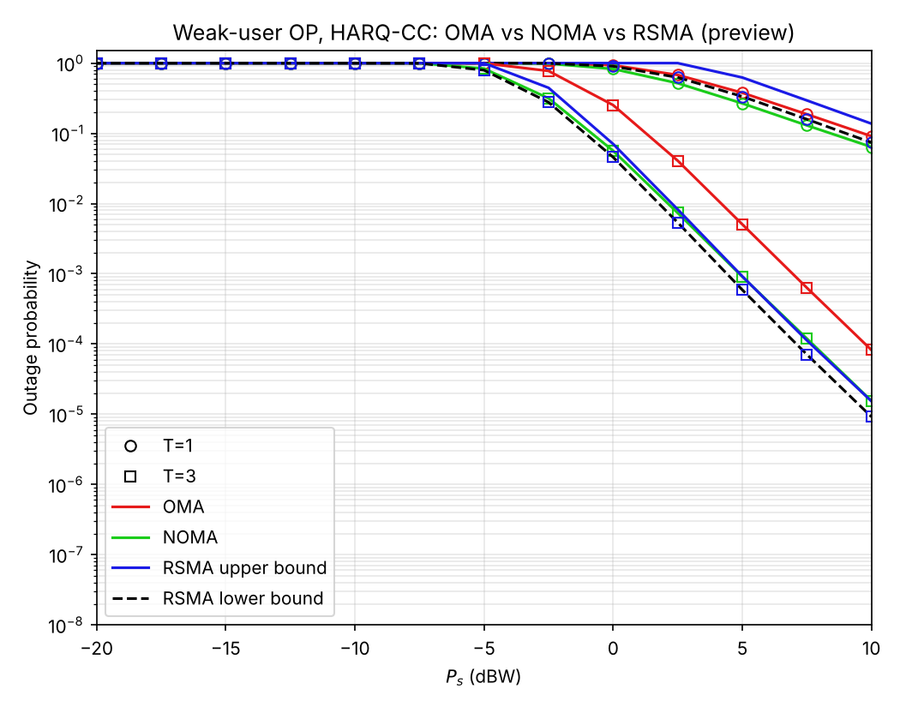
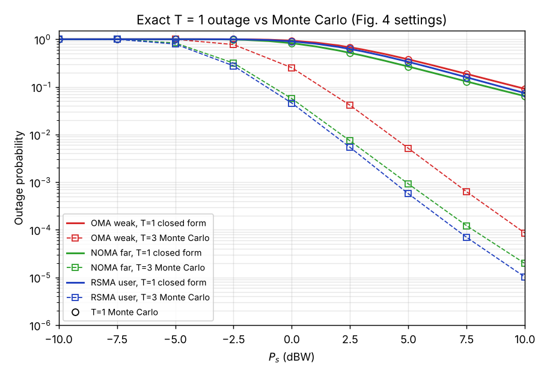

# rsma-istn-outage

MATLAB study of outage probability for **OMA, NOMA and RSMA** in an integrated satellite-terrestrial network (one LEO satellite, K ground users, Shadowed-Rician fading, HARQ with chase combining). It reproduces and checks

> C. Hu *et al.*, "Outage Analysis of RSMA Enabled Integrated Satellite-Terrestrial Networks," *IEEE Trans. Veh. Technol.*, vol. 74, no. 6, pp. 10023–10028, Jun. 2025.

and uses the NOMA modelling of its reference [12]:

> C. K. Singh *et al.*, "Performance Analysis With Deep Learning Assay for Cooperative UAV-Borne IRS NOMA Networks Under Non-Ideal System Imperfections," *IEEE Trans. Veh. Technol.*, vol. 73, no. 1, pp. 1065–1083, Jan. 2024.

---

## Repository layout

| Folder | Contents |
|---|---|
| [`01_fig4_monte_carlo/`](01_fig4_monte_carlo) | Monte Carlo reproduction of Fig. 2 and Fig. 4 of Hu *et al.* (weak-user outage, OMA vs NOMA vs RSMA, T = 1 and T = 3). Also holds the shared parameter file and channel generator. |
| [`02_sinr_closed_form_outage/`](02_sinr_closed_form_outage) | All SINRs of the three schemes in one common form, the **exact closed-form outage for T = 1**, an independent Monte Carlo check, an SINR-ceiling report, and a hardware-impairment extension. |

No toolboxes are needed (`randg`, `besselj`, `gammainc` and `gammaln` are core MATLAB). Run every script from inside its own folder. The scripts in folder 02 call `setup_paths` themselves to reach the shared files in folder 01.

```matlab
% week 1: Monte Carlo
cd 01_fig4_monte_carlo
fig4_reproduce        % weak-user OP, T = 1 and T = 3
fig2_check            % K = 3 RSMA sanity check against Fig. 2

% week 2: SINRs and closed-form outage
cd ../02_sinr_closed_form_outage
ceiling_report        % every stream: delta, vartheta, ceiling, reachable?
verify_closed_form    % closed form vs two independent Monte Carlo codes
hi_impact             % extension: hardware impairments
```

---

## 1. System model

The satellite sends one superposed signal per round. User $k$ in round $t$ receives

$$y_{k,t} = G_k h_{k,t} x_s + n_{k,t}, \qquad X = P_s g_k |h_{k,t}|^2,\quad g_k = G_k^2/N_0 \approx 0.74\ \text{dB}$$

The power splits used in the paper's Fig. 4 are as follows:

| Scheme | Power split | Target |
|---|---|---|
| RSMA (1-layer) | $\alpha_c = 0.4$ common, $\alpha_1=\alpha_2=0.3$ private | $\gamma_{c,th}=\gamma_{p,th}=0.4$ |
| NOMA | $a_1 = (1+\alpha_c)/2 = 0.7$ far, $a_2 = 0.3$ near | $2^{R_1}-1$, $R_1 = R_c/2 + R_p$ |
| OMA (TDMA) | full power, half the time each | $2^{2R_1}-1$ |

## 2. SINR of every decoding step: one formula

Every SINR in the paper, and in its NOMA reference, has the form

$$\gamma = \frac{\delta\, X}{\vartheta\, X + 1}, \qquad \text{ceiling: } \gamma \to \frac{\delta}{\vartheta} \text{ as } P_s \to \infty$$

where $\delta$ is the power fraction of the stream being decoded and $\vartheta$ is the power fraction that still interferes ($+\lambda^2$ with hardware impairments).

| Stream | $\delta$ | $\vartheta$ | Ceiling (Fig. 4) |
|---|---|---|---|
| OMA, own slot | $1$ | $0$ | ∞ |
| NOMA far user decodes $s_1$ | $a_1$ | $a_2$ | 7/3 |
| NOMA near user decodes $s_1$ (SIC step) | $a_1$ | $a_2$ | 7/3 |
| NOMA near user decodes $s_2$ | $a_2$ | $0$ | ∞ |
| RSMA common $s_c$, eq. (5) | $\alpha_c$ | $\sum_j \alpha_j$ | 2/3 |
| RSMA private $s_k$, eq. (6) | $\alpha_k$ | $\sum_{j\ne k}\alpha_j$ | 1 (K = 2), 1/2 (K = 3) |

If a target is at or above its ceiling, the stream can never be decoded, and outage = 1 at any power. Under HARQ-CC this is also the condition for full diversity $D = T$ (eq. (16) of the paper). `ceiling_report.m` prints this table.

## 3. Outage probability

**With HARQ-CC (T rounds)** a stream is decoded when the accumulated SINR reaches its target, $\sum_{t=1}^{T}\gamma_t \ge \gamma_{th}$. A user is in outage if *any* stream it needs fails:

| Scheme | Outage event |
|---|---|
| OMA | $\sum_t \gamma^{\text{OMA}}_t < \gamma_{th}$ |
| NOMA far | $\sum_t \gamma_{1\to1,t} < \gamma_{th}$ |
| NOMA near | $\sum_t \gamma_{2\to1,t} < \gamma_{th}$ **or** $\sum_t \gamma_{2\to2,t} < \gamma_{th}$ |
| RSMA | $A_1 \cup A_2$: common fails **or** private fails, bounded by $\max\{\Pr A_1,\Pr A_2\} \le P \le \Pr A_1 + \Pr A_2$ (eq. (8)) |

**Exact closed form for T = 1** (the method of Singh *et al.*, eqs. (12)–(13)). Each condition "$\gamma \ge \gamma_{th}$" is a threshold on the same $|h|^2$:

$$\gamma \ge \gamma_{th} \iff |h|^2 \ge \xi = \frac{\gamma_{th}}{P_s g_k(\delta - \vartheta\gamma_{th})}$$

So "decode every needed stream" reduces to "$|h|^2$ is above the **largest** threshold", and the outage is exact, with no bounds:

$$P_{\text{out}} = F_{|h|^2}\big(\max_l \xi_l\big), \qquad F_{\text{weak}} = 1-(1-F)^2,\quad F_{\text{strong}} = F^2$$

using the Shadowed-Rician CDF (integral of eq. (4)):

$$F_{|h|^2}(x) = \lambda \sum_{n=0}^{\infty} \frac{(m)_n\,\delta_{SR}^n}{n!\,\beta^{n+1}}\, P(n+1, \beta x)$$

where $P$ is the regularised lower incomplete gamma function (`gammainc`). For T > 1 the sums over rounds break the single-threshold argument. The code then uses Monte Carlo, and the paper uses the bounds above.

---

## 4. Files

### `01_fig4_monte_carlo/`

| File | What it does |
|---|---|
| `istn_params.m` | All parameters (link budget, Shadowed-Rician AS, power splits, thresholds), each tagged as taken from the paper or assumed |
| `sr_gain.m` | Draws Shadowed-Rician $\lvert h\rvert^2$ |
| `oma_outage.m` | TDMA, weak and strong user OP |
| `noma_outage.m` | NOMA far (weak) and near (strong, with SIC) user OP |
| `rsma_outage.m` | 1-layer RSMA user OP, plus $\Pr A_1$ and $\Pr A_2$ for the eq. (8) bounds |
| `fig4_reproduce.m` | Runs all three schemes for T = 1 and T = 3 and plots them like Fig. 4 |
| `fig2_check.m` | K = 3 RSMA, compared with Fig. 2 |



### `02_sinr_closed_form_outage/`

| File | What it does |
|---|---|
| `sinr_streams.m` | The table in Section 2: $\delta$, $\vartheta$, threshold, ceiling, reachable, for every stream |
| `sinr_value.m` | $\gamma = \delta X/(\vartheta X + 1)$ |
| `threshold_on_gain.m` | $\xi = \gamma_{th}/(\rho(\delta-\vartheta\gamma_{th}))$, or `Inf` above the ceiling |
| `sr_cdf.m` | Closed-form Shadowed-Rician CDF (series above) |
| `op_closed_form_T1.m` | Exact T = 1 outage: OMA weak/strong, NOMA far/near, RSMA user/weakest, $\Pr A_1$, $\Pr A_2$ |
| `mc_outage.m` | Monte Carlo for any T, computed straight from the SINR formula (independent of the threshold algebra), with hardware-impairment support |
| `ceiling_report.m` | Prints Section 2's table for the Fig. 4 and Fig. 2 settings |
| `verify_closed_form.m` | Closed form vs `mc_outage` vs the week-1 functions; also checks `sr_cdf` against samples |
| `hi_impact.m` | Extension: OP for hardware-impairment levels $\lambda = 0, 0.1, 0.2$ |
| `setup_paths.m` | Adds folder 01 to the path |



*Both preview images were generated by a line-by-line Python port of this code. MATLAB output should match up to Monte Carlo noise.*

---

## 5. Verification

Checked with the line-by-line port (N = 2·10⁶ samples per point, T = 1, P_s = −20 … 10 dBW). Only points with at least 100 outage events are used.

| Check | Max relative error |
|---|---|
| `sr_cdf` vs empirical CDF of `sr_gain` (x = 0.01 … 2) | absolute error < 6·10⁻⁴ |
| Mean of $\lvert h\rvert^2$ vs $2b+\Omega = 1.087$ | 0.06 % |
| Closed form vs `mc_outage`, all eight outputs | ≤ 1.5 % |
| Closed form vs week-1 `oma/noma/rsma_outage` | ≤ 2.6 % |
| Fig. 2 settings (K = 3), RSMA user | 0.04 % |
| With hardware impairments, λ = 0.1 and 0.2 | ≤ 3.3 % (N = 10⁶) |

Exact T = 1 values at the Fig. 4 settings:

| P_s (dBW) | 0 | 2.5 | 5 | 7.5 | 10 |
|---|---|---|---|---|---|
| OMA weak | 0.934 | 0.678 | 0.378 | 0.187 | 0.0910 |
| NOMA far | 0.827 | 0.518 | 0.267 | 0.130 | 0.0640 |
| RSMA user | 0.902 | 0.625 | 0.335 | 0.159 | 0.0740 |
| RSMA weakest of 2 | 0.991 | 0.860 | 0.558 | 0.292 | 0.1425 |

## 6. Findings about the paper

- **Fig. 2 reproduces closely** with the stated parameters. The ceilings $\theta_c = 2/3$ and $\theta_p = 1/2$ quoted in the paper match `ceiling_report`.
- **The scheme ranking in Fig. 4 reproduces** (T = 1: NOMA < RSMA < OMA; T = 3: RSMA < NOMA < OMA). The published curves, however, sit about 5–6 dB to the left of ours, so Fig. 4 must use a setting the paper doesn't state.
- **At the Fig. 4 settings the common stream decides RSMA's outage at T = 1**: $\xi_c \ge \xi_p$, so $P_{\text{out}} = \Pr A_1$ exactly. The exact value at 10 dBW is 0.074. The T = 1 RSMA point we read off the published Fig. 4 at that power (≈ 0.018) is below this, which can't happen under the stated parameters.
- **The comparison is tilted towards RSMA**: the paper compares a generic RSMA user against the *weakest* NOMA/OMA user. Ordering RSMA the same way raises its T = 1 OP at 10 dBW from 0.074 to 0.143, which is worse than NOMA's 0.064.
- **NOMA is a special case of RSMA** ($W_1 \to$ common only, $W_2 \to$ private only). At the paper's fixed split, NOMA's weak user beats RSMA, and RSMA wins for the strong user. This is a trade-off, not a strict ranking.

## 7. Assumptions not stated in the paper

- Users at beam centre ($\theta = 0 \Rightarrow G_s = G_{max}$), all at $d = 1000$ km.
- OMA = TDMA with half the time per user, so the in-slot target is $2^{2R_1}-1$.
- NOMA/OMA weak user = minimum of the two users' channel gains in each round. RSMA user $k$ is the generic i.i.d. user, as in the paper's analysis (`p.rsma_ordered = true` orders RSMA too).
- Perfect SIC and perfect CSI, as in the paper.

## 8. Extension: hardware impairments

Following Singh *et al.*, transceiver distortion adds $\lambda^2$ (EVM²) to every $\vartheta$, because it scales with the signal just like interference does. This lowers every ceiling. With the paper's targets, a stream becomes undecodable once λ exceeds the value below:

| Stream | RSMA common | RSMA private | OMA | NOMA $s_1$ |
|---|---|---|---|---|
| Breaks at λ > | 0.632 | 0.671 | 0.757 | 0.875 |

Realistic EVMs (λ ≤ 0.2) only shift the curves. RSMA's common stream is the most sensitive. Set `p.hi_lambda` in `istn_params.m` (default 0 = the paper's ideal hardware).
