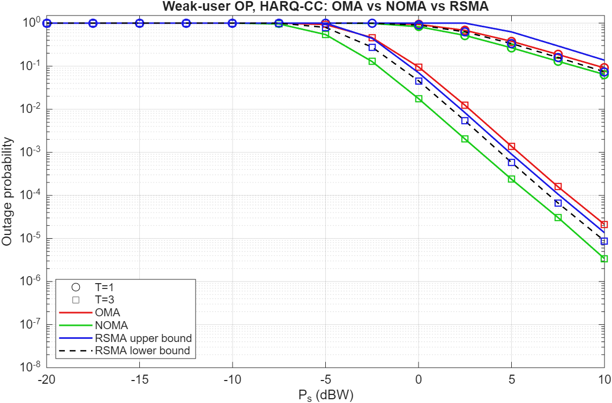
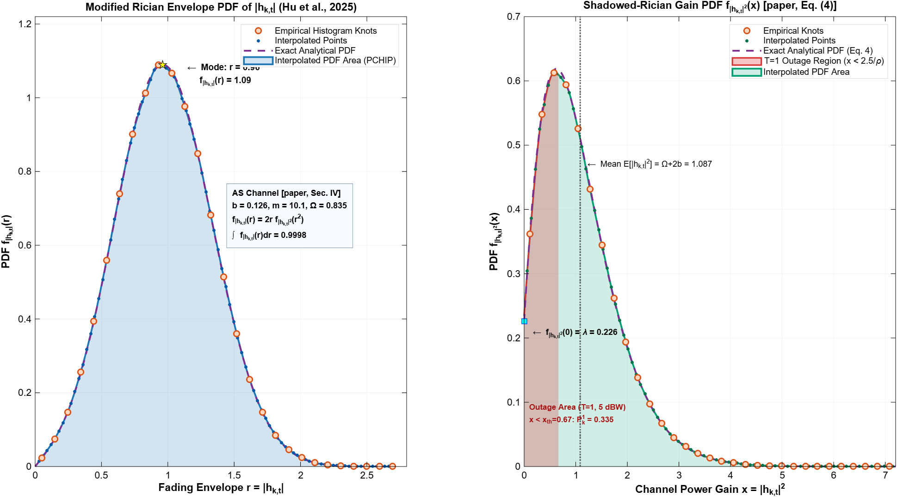

# rsma-istn-outage

MATLAB Monte Carlo simulation of weak-user outage probability for HARQ-CC aided OMA, NOMA and RSMA in integrated satellite-terrestrial networks, reproducing Fig. 4 of Hu et al., "Outage Analysis of RSMA Enabled Integrated Satellite-Terrestrial Networks", IEEE TVT 2025.



*Preview generated by a line-by-line Python port of this code (N = 1e7 per point); MATLAB output should match up to Monte Carlo noise.*

## Fig. 4 reproduction — HARQ-CC OMA vs NOMA vs RSMA (Hu et al., IEEE TVT 2025)

Put all `.m` files in one folder, then in MATLAB:

```
fig4_reproduce    % main figure (weak-user OP, T = 1 and T = 3)
fig2_check        % sanity check against the paper's Fig. 2 (K = 3 RSMA)
oma_outage        % each scheme also runs on its own with no arguments
noma_outage
rsma_outage
```

No toolboxes needed (`randg`, `besselj` are core MATLAB).

| File | What it does |
|---|---|
| `istn_params.m` | All parameters from the paper (link budget, Shadowed-Rician AS, power splits, thresholds) |
| `sr_gain.m` | Draws Shadowed-Rician `|h|^2` |
| `oma_outage.m` | TDMA, weak & strong user OP |
| `noma_outage.m` | NOMA far (weak) and near (strong, with SIC) user OP |
| `rsma_outage.m` | 1-layer RSMA user OP + Pr{A1}, Pr{A2} for the eq. (8) bounds |
| `fig4_reproduce.m` | Runs all three for T = 1, 3 and plots like Fig. 4 |

## Assumptions not stated in the paper
- Users at beam centre (θ = 0 ⇒ Gs = Gmax).
- OMA = TDMA with half the time per user ⇒ in-slot threshold 2^(2R1) − 1.
- NOMA/OMA weak user = min of the two users' channel gains in each round.
  RSMA user k is the generic i.i.d. user, as in the paper's analysis
  (set `p.rsma_ordered = true` to order RSMA too).

## Known gap vs. the published figure
The model reproduces Fig. 2 closely, and the ranking in Fig. 4
(T=1: NOMA < RSMA < OMA; T=3: RSMA < NOMA < OMA), but the published
Fig. 4 curves sit about 5–6 dB to the left of these. Fig. 4 must use
some setting the paper doesn't state.


# Shadowed-Rician Channel PDF & Outage Visualization (`Rician_Dist.m`)

A standalone MATLAB script that simulates, interpolates, and validates the small-scale **Shadowed-Rician (modified Rician)** fading distribution and single-round ($T=1$) outage probability for Rate-Splitting Multiple Access (RSMA) Integrated Satellite-Terrestrial Networks (ISTNs).

Based on:
* C. Hu *et al.*, *"Outage Analysis of RSMA Enabled Integrated Satellite-Terrestrial Networks,"* IEEE Trans. Veh. Technol., vol. 74, no. 6, pp. 10023–10028, June 2025.

## Overview & Features

1. **Monte Carlo Channel Synthesis:** Generates $N_{\text{mc}} = 5 \times 10^5$ complex fading realizations $h_{k,t} = A e^{j\phi} + Z$ using a Nakagami-$m$ Line-of-Sight (LoS) envelope $A$ and complex Gaussian multipath scatter $Z$.
2. **PCHIP PDF Interpolation & Area Shading:** Extracts empirical histogram knots for both the fading envelope $|h_{k,t}|$ and power gain $|h_{k,t}|^2$, interpolates them smoothly via shape-preserving piecewise cubic Hermite interpolation (`interp1(..., 'pchip')`), and shades the probability density area.
3. **Analytical Validation (Eq. 4):** Overlays the exact closed-form PDF $f_{|h_{k,t}|^2}(x) = \lambda e^{-\beta x} \, {}_1F_1(m; 1; \delta x)$ and Jacobian-transformed envelope PDF $f_{|h_{k,t}|}(r) = 2r\,f_{|h_{k,t}|^2}(r^2)$.
4. **Outage Region Visualization ($T=1$):** Computes and shades the single-round outage region $\Pr\{|h_{k,t}|^2 < x_{\text{th}}\} = F_1(x_{\text{th}}) = 0.335$ at $P_s = 5\text{ dBW}$ against the exact Gamma-mixture series CDF.

## Default Simulation Parameters

| Parameter | Symbol | Value | Source |
| :--- | :--- | :--- | :--- |
| Multipath half-power | $b$ | $0.126$ | Hu *et al.*, Sec. IV (Average Shadowing) |
| LoS fading severity | $m$ | $10.1$ | Hu *et al.*, Sec. IV (Average Shadowing) |
| Average LoS power | $\Omega$ | $0.835$ | Hu *et al.*, Sec. IV (Average Shadowing) |
| Link budget CNR | $g_k = \mathcal{G}_k^2 / N_0$ | $1.186$ ($0.74\text{ dB}$) | Hu *et al.*, Eqs. (3), (5) & Sec. IV |
| Transmit power / SNR | $P_s$ / $\rho = P_s g_k$ | $5\text{ dBW}$ / $3.75$ | Hu *et al.*, Fig. 2 & Fig. 4 |
| RSMA power split | $\alpha_c, \alpha_1, \alpha_2$ | $0.4, 0.3, 0.3$ | Hu *et al.*, Fig. 4 ($K=2$) |
| SINR thresholds | $\gamma_{c,\text{th}}, \gamma_{p,\text{th}}$ | $0.4, 0.4$ | Hu *et al.*, Fig. 4 |


## Outputs

* **Command Window:** Prints the derived link budget ($\rho$), Shadowed-Rician constants ($\lambda, \beta, \delta$), integrated probability area checks ($\approx 1.0000$), and a comparison between numerical PCHIP outage integration and the exact analytical $T=1$ outage probability ($0.335$).
* **Figure Window:**
  * **Left Subplot:** Modified Rician envelope PDF $f_{|h_{k,t}|}(r)$ showing empirical histogram knots, PCHIP interpolated points, shaded probability area, and peak mode ($r \approx 0.95$).
  * **Right Subplot:** Shadowed-Rician power gain PDF $f_{|h_{k,t}|^2}(x)$ annotating the zero-gain intercept $f(0) = \lambda \approx 0.226$, theoretical mean $\mathbb{E}[|h_{k,t}|^2] = 1.087$, and shaded $T=1$ outage region ($x < 0.6667$).

### Generated Plot


*Figure 1: Empirical PCHIP-interpolated PDFs vs. exact analytical Shadowed-Rician distributions (Eq. 4) for envelope $|h_{k,t}|$ (left) and power gain $|h_{k,t}|^2$ with the shaded $T=1$ outage region at $P_s = 5\text{ dBW}$ (right).*
