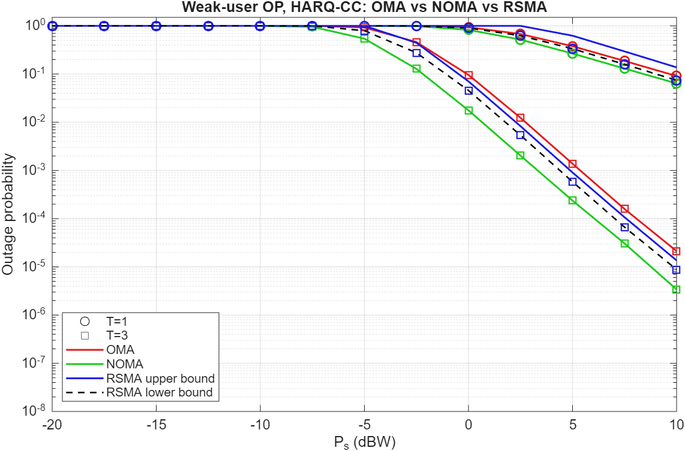

# rsma-istn-outage (v2)

MATLAB Monte Carlo simulation of weak-user outage probability for HARQ-CC aided OMA, NOMA and RSMA in integrated satellite-terrestrial networks, reproducing Fig. 4 of Hu et al., "Outage Analysis of RSMA Enabled Integrated Satellite-Terrestrial Networks", IEEE TVT 2025.



*Preview generated in MATLAB R2025b from v2 (ordering 'first', N = 1e7). Fig. 2 check: `fig2_check_v2.png`. Console output: `run_output_v2.txt`.*

## How to run

Put all `.m` files in one folder, then in MATLAB:

```
fig4_reproduce    % main figure (weak-user OP, T = 1 and T = 3)
fig2_check        % sanity check against the paper's Fig. 2 (K = 3 RSMA), prints ours vs paper
oma_outage        % each scheme also runs on its own with no arguments
noma_outage
rsma_outage
```

No toolboxes needed: v2 draws Gamma samples with its own Marsaglia–Tsang routine inside `sr_gain.m` (v1 used `randg`, which needs the Statistics and Machine Learning Toolbox and failed on a plain MATLAB install). Also runs in GNU Octave.

| File | What it does |
|---|---|
| `istn_params.m` | All parameters from the paper (link budget, Shadowed-Rician AS, power splits, thresholds), plus the assumed ones, marked [ASSUMED] |
| `sr_gain.m` | Draws Shadowed-Rician `|h|^2` (checked against the paper's eq. 4 CDF) |
| `order_users.m` | **new in v2**: picks the weak/strong user's channels over the T rounds (`p.order`) |
| `oma_outage.m` | TDMA, weak and strong user OP |
| `noma_outage.m` | NOMA far (weak) and near (strong, with SIC) user OP |
| `rsma_outage.m` | 1-layer RSMA user OP, plus Pr{A1} and Pr{A2} for the eq. (8) bounds |
| `fig4_reproduce.m` | Runs all three for T = 1, 3 and plots like Fig. 4 (`fairRSMA = true` adds the RSMA weak-user curve) |

## Changes from v1

1. **Weak/strong ordering across HARQ rounds (fix).** v1 took `min/max` of the two users' gains in *every round*. Under HARQ-CC the identical superposed packet is resent each round, so the roles (power split, SIC order) cannot change between rounds. v1's "weak user" was therefore a different physical user in different rounds. v2 adds `p.order`:
   - `'first'` (default): roles are fixed by the round-1 channel and kept for all rounds.
   - `'sum'`: roles are fixed by the accumulated gain (a genie benchmark). It gives almost the same results as `'first'`.
   - `'round'`: the v1 behaviour, kept for comparison.

   T = 1 results are unchanged. At T = 3, NOMA and OMA OP drop by about 4x at 5 dBW.
2. **No toolbox dependency.** `sr_gain` no longer calls `randg` (Statistics Toolbox). It uses a built-in Marsaglia–Tsang Gamma sampler, checked against eq. 4 CDF.
3. **Power check.** `rsma_outage` now errors if `alpha_c + sum(alpha_p) != 1` (eq. 2).
4. **`fig2_check`** uses the values actually read off the paper's Fig. 2, prints ours vs paper, has a legend, and drops zero-OP points from the log plot.
5. **`fig4_reproduce`** prints the ordering in use and has a `fairRSMA` option.
6. **`p.extra_gain_dB`** is a diagnostic knob (default 0). See the known gaps below.

## Assumptions not stated in the paper
- Users are at beam centre (θ = 0, so Gs = Gmax).
- OMA = TDMA with half the time per user, so the in-slot threshold is 2^(2R1) − 1. With 2^R1 − 1 instead, OMA would beat NOMA at T = 1, contradicting the paper's ranking.
- Weak/strong roles are fixed by the round-1 channel (`p.order = 'first'`).
- RSMA user k is the generic i.i.d. user, as in the paper's analysis (eqs. 9 and 11), whose curves are what Fig. 4 shows for RSMA.
- E|h|² = Ω + 2b = 1.087 is not normalised. The paper doesn't normalise it either.

## Known gaps vs the published figures
- **Fig. 2:** T = 2 matches within about 10%, and T = 3 within 10–25% (under 1 dB). The paper's T = 1 points are higher than ours (2x at 20 dBW).
- **Fig. 4 sits about 6 dB right of the paper.** The paper's Fig. 4 seems internally inconsistent with its Fig. 2. Both use α_c = 0.4 with 0.6 of the power on the private streams, so Pr{A1} (common-stream outage) is the same function of Ps in both. With the SNR that reproduces Fig. 2, Pr{A1} = 0.074 at 10 dBW, T = 1. Yet Fig. 4 shows the full RSMA OP at about 0.018 there, and OP ≥ Pr{A1}. Setting `p.extra_gain_dB = 6` brings our RSMA curves (T = 1, 3) and the OMA T = 1 curve to within about 25% of the published ones.
- **NOMA/OMA at T = 3.** Even with +6 dB and the v1 per-round ordering (the most pessimistic choice), the paper's NOMA and OMA T = 3 curves are worse than ours. The paper's NOMA/OMA HARQ model is not fully specified.
- **Ranking at T = 3 depends on ordering.** With physically consistent ordering, NOMA's weak user beats RSMA's generic user (2.4e-4 vs 5.9e-4 at 5 dBW), and RSMA's own weak user is worse still (1.1e-3). The paper's "RSMA-HARQ is best" result compares a generic RSMA user with the weakest NOMA/OMA user.
