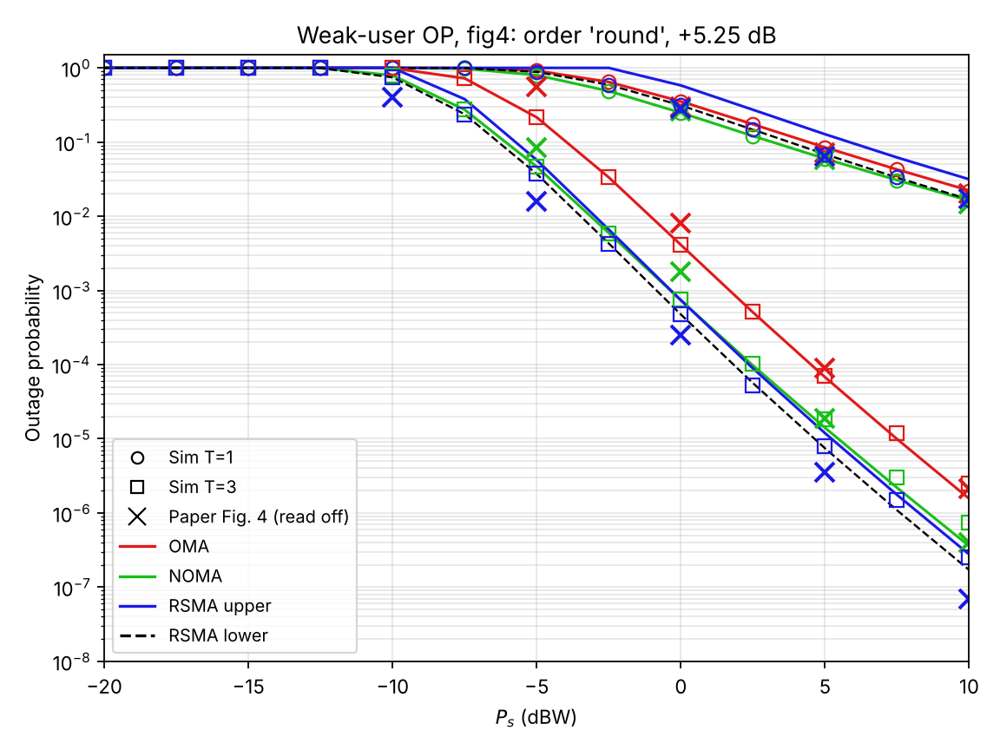

# rsma-istn-outage

MATLAB Monte Carlo and numerical-analytic outage probability for HARQ-CC aided OMA, NOMA and RSMA in integrated satellite-terrestrial networks. It reproduces Fig. 4 of Hu et al., "Outage Analysis of RSMA Enabled Integrated Satellite-Terrestrial Networks", IEEE TVT 2025. NOMA/OMA are modelled as in the paper's reference [12] (Singh, Upadhyay, Lehtomäki, Juntti, IEEE TVT 2024).

**Branch `noma-findings`:** see [`docs/FINDINGS.md`](docs/FINDINGS.md) for the results, the NOMA model taken from [12], and the paper-verification notes.



## Quick start

Put all `.m` files in one folder, then in MATLAB:

```
fig4_reproduce       % Fig. 4: 'fig4' preset (best match) and 'physical' setting
fig2_check           % sanity check against the paper's Fig. 2 (K = 3 RSMA)
verify_paper         % closed forms vs Monte Carlo, eq (9)/(11) check, Fig 3 vs Fig 4
noma_imperfections   % hardware impairments and imperfect SIC from [12]
```

No toolboxes needed.

| File | What it does |
|---|---|
| `istn_params.m` | All parameters, tagged [paper] / [12] / [ASSUMED]. Name-value options: `'order'`, `'extra_gain_dB'`, `'lambda_hi'`, `'isic'`, `'Omega_I_dB'`, `'preset','fig4'` |
| `sr_gain.m` | Draws Shadowed-Rician \|h\|² |
| `sr_cdf.m` | Exact CDF of a sum of T S-R gains (Gamma-mixture series) |
| `order_users.m` | Weak/strong user per HARQ round: `'round'`, `'first'`, `'none'` |
| `oma_outage.m` | TDMA, weak and strong user (Monte Carlo) |
| `noma_outage.m` | NOMA far and near user, [12]'s SINR with optional HI and I-SIC (Monte Carlo) |
| `rsma_outage.m` | 1-layer RSMA user OP plus Pr{A1}, Pr{A2} (Monte Carlo) |
| `analytic_outage.m` | Numerical "analytical" curves for all three schemes (exact CDF, then convolution) |
| `rsma_bounds_analytic.m` | Hu et al. eqs. (9)/(11) as printed (Gauss–Chebyshev + Gaver–Stehfest) |
| `closed_form_T1.m` | Exact T = 1 outage for OMA, NOMA (far/near) and RSMA |
| `paper_fig4_points.m` | Values read off the published Fig. 4 |
| `python/` | Python mirror used to generate `figures/` and `figures/results.json` |

## Assumptions not stated in Hu et al.
- Users at beam centre (Gs = Gmax).
- OMA = TDMA with K = 2 slots, so the threshold is 2^(2R1) − 1. Ref. [12] uses the same rule (2^(KR) − 1).
- The weak user is chosen per HARQ round (`'round'`, [12]'s order statistics in every round). `'first'` is available for the physically fixed-role case.
- The RSMA user is the generic i.i.d. user, as in eqs. (9)/(11).

## Known gap
Fig. 4 needs about +5.25 dB relative to the link budget that reproduces Figs. 2 and 3. Fig. 3 at K = 2 and Fig. 4 use the same RSMA parameters but differ by about 6× (T = 1) and about 250× (T = 3) at 10 dBW. Details are in `docs/FINDINGS.md`.
